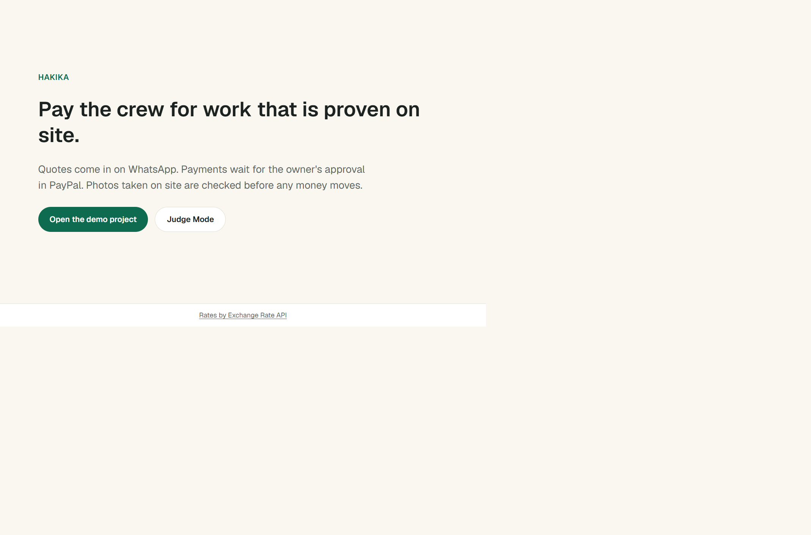
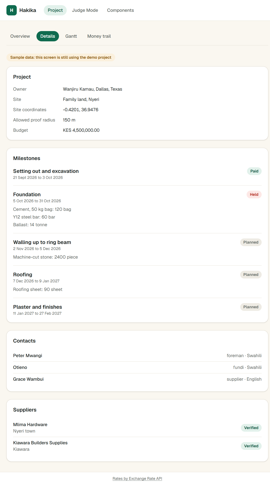
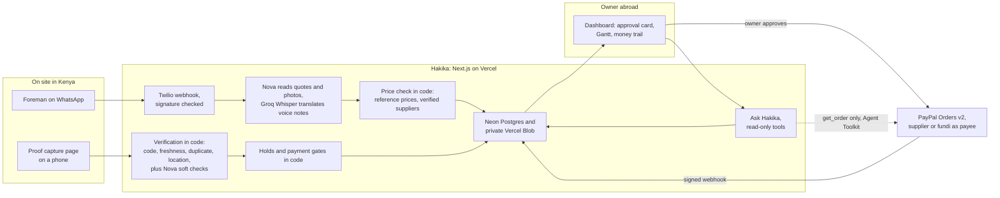

# Hakika

**Pay for building work back home only when the work is real.**

Hakika (Swahili for "certainty") helps people abroad pay for a house being built in Kenya. The foreman sends quotes and requests on WhatsApp. Hakika reads them, checks the prices against verified suppliers and prepares a payment that the owner approves in PayPal. PayPal pays the supplier directly, so Hakika never holds anyone's money. Before the next payment can go out, every delivery and milestone needs proof: a one-time code written on paper or on the delivery, photographed at the site within 30 minutes. If the photo was used before, was taken somewhere else or doesn't show the code, the next payment is held and the owner sees exactly why.

**Live demo:** https://tryhakika.vercel.app · open **Judge Mode** to run the whole story without a phone.

Everyone in this demo is fictional, and every payment runs in the PayPal sandbox. No real money moves.





## Try it (no phone needed)

1. Open https://tryhakika.vercel.app/judge and press **Reset demo**. Everyone shares one demo project, so a reset is allowed once every 30 seconds.
2. Run **Inflated quote**. Peter, the foreman, sends a photo of a quote for 50 bags of cement at KES 65,000. Hakika finds the price 18% above the verified median and the supplier unverified, and recommends a verified supplier at KES 55,000. Open the approval card and approve the USD amount in PayPal with the sandbox buyer login given in the Devpost testing instructions.
3. Run **Valid delivery**. A photo of the delivery with the right code, taken at the site, is **Verified**.
4. Run **Recycled photo**. A "foundation done" photo that was sent before, from 37 km away, with no code, is **Suspicious**. The foundation's labour payment is held.
5. Open the proof review to see every check, the timeline (Gantt) to see the held payment gate, and the money trail for every request, payment and verdict. On the project page, ask Ask Hakika "Why is the foundation payment held?".

Judge Mode sends its messages through the same pipeline as WhatsApp. Its AI outputs were recorded once from Amazon Nova and are replayed (each is labelled "Recorded"); the checks, holds and amounts are worked out again by code every time.

## How it works



1. **A request arrives on WhatsApp.** Text, a voice note, a quote photo or a location pin from a known site contact. Voice notes are translated to English by Groq Whisper; Amazon Nova turns a quote photo into line items (item, quantity, unit price in KES, supplier). Replies to people on site are fixed templates in English and Swahili.
2. **Code checks the price.** Each line is compared with reference prices and the verified suppliers: more than 15% above the median is a warning, more than 30% must be acknowledged before paying, a quantity more than 10% above what's left in the milestone plan is a warning, an unverified supplier is flagged with the cheapest verified alternative, and a verified supplier at least 5% cheaper for the whole order is recommended. Nova then words the findings for the owner, and a number guard rejects any amount that isn't in the findings.
3. **The owner approves in PayPal.** The server creates an Orders v2 order with the verified supplier (or, for labour, the fundi) as the payee. Prices are kept in KES; orders are in USD at a daily rate that is saved with each payment. The server captures the approved order and records it; PayPal's signed webhooks keep the money trail in sync, and duplicates are ignored.
4. **Proof is requested.** After a delivery, or when the foreman says a milestone is done, Hakika issues a 4-character code (no look-alike characters) and a single-use link that expires after 30 minutes.
5. **Code verifies the proof.** See below. A suspicious proof holds every new payment on its milestone until fresh proof passes or the owner overrides with a reason, which is recorded.
6. **The timeline moves.** A Bryntum Gantt shows each milestone and the labour payment it unlocks, coloured by status.

## How verification works

| Check | Passes when | Type |
|---|---|---|
| Code | The code read from the photo matches the issued code (ignoring case and spaces) | Hard |
| Freshness | Uploaded within 30 minutes of the code being issued | Hard |
| New photo | Its 64-bit perceptual hash (dHash) differs by more than 8 bits from every earlier proof in the project | Hard |
| At the site | Taken within the site radius (150 m in the demo) plus the reported GPS accuracy, counted up to 100 m | Hard |
| Real scene | Nova doesn't see a photo of a screen or of a printout | Soft |
| Expected items | A delivery photo shows what was paid for | Soft |
| Consistency | A progress photo shows the same site as earlier proofs | Soft |

**Outcome rule (code, not the model):** any hard fail → **Suspicious**: the payment is held and the owner sees the evidence. Otherwise any soft fail or unknown → **Needs fresh proof**: a new code goes out. Everything passes → **Verified**: the next payment unlocks. Location comes from the capture page or a shared WhatsApp pin, never from photo metadata (WhatsApp strips it).

## Rules that keep money safe

- **Code decides whether money can move.** The models only read, compare and explain. No model output can trigger, change or approve a payment.
- **Only the owner's PayPal approval moves money.** Hakika never holds funds; PayPal pays the supplier or fundi directly.
- **The server computes every amount from the database.** The browser only sends IDs, never a total.
- **WhatsApp text is data, never instructions.** Text in a photo that reads like instructions to the AI is ignored, and the owner is told.
- **People on site only get fixed templates** in English and Swahili. The model never writes to a foreman, fundi or supplier.
- **Ask Hakika is read-only.** Its tools are bound to the project the server chose and return text that Hakika's code wrote. Its only PayPal call is the Agent Toolkit's `get_order`, for orders in that project. Only links to records a tool returned are shown, every number in an answer must appear in the records, and questions are capped (100 a day overall, 10 per IP per hour).
- **Webhooks are verified:** Twilio's request signature and PayPal's webhook signature are checked before anything is stored.

## AI models and tools

| Tool | How Hakika uses it |
|---|---|
| PayPal Orders v2 | Each payment, with the verified supplier or fundi as payee; captured by the server |
| PayPal JavaScript SDK | The owner's approval button (PayPal and card) |
| PayPal Webhooks | Signature-verified capture events keep the money trail in sync |
| PayPal Agent Toolkit | Read-only order lookups (`get_order`) inside Ask Hakika |
| Amazon Nova 2 Lite on Bedrock | Reads quote photos and messages, inspects proof photos, words the owner summary, runs Ask Hakika |
| Groq Whisper large-v3 | Translates Swahili voice notes into English |
| Twilio Sandbox for WhatsApp | Messages with the foreman and site contacts |
| Bryntum Gantt | Milestone timeline with payment gates |
| Next.js, TypeScript, Drizzle, Neon Postgres, Vercel Blob, sharp | The app, the database, private photo storage, image hashing |

## What's real and what's simulated

- **Real:** the WhatsApp pipeline (through Twilio's sandbox), the PayPal sandbox orders, captures and webhooks, the price check, the verification engine, holds and overrides, the money trail with CSV export, Ask Hakika on Nova.
- **Simulated:** Judge Mode's WhatsApp conversation (same pipeline, nothing sent to a phone) and its recorded AI outputs. In "Valid delivery", if no quote has been approved in PayPal first, the delivery is set up as paid without a PayPal payment, and Judge Mode says so.
- **Demo data:** the project, people, suppliers and reference prices are fictional. Reference prices are indicative.

## Limits and out of scope

- Sandbox only: no real money, no escrow, and Hakika never holds funds. Every payee needs a PayPal account (Kenyan accounts can withdraw to M-PESA through PayPal).
- No owner sign-in yet: the demo has one owner and one project.
- Not in scope: land and title checks, structural engineering judgments, a direct M-PESA integration.
- Handwritten codes are read by a vision model, so a hard-to-read code fails safe: the proof isn't verified and fresh proof is requested.
- The PayPal Agent Toolkit brings its own dependencies (AI SDK 4, zod 3, LangChain and others), which `npm audit` and Dependabot flag. Hakika only loads the toolkit on the server for `get_order`.

## Run it locally

You need Node 24, a Postgres database (Neon's free tier works), a private Vercel Blob store for photos, and sandbox keys: PayPal Developer, Amazon Bedrock with Nova access, Groq, and Twilio's WhatsApp sandbox. Ask Hakika also reads `ASK_IP_HASH_KEY` (any long random string) to hash IP addresses for its question cap.

```bash
npm ci
cp .env.example .env.local   # fill in sandbox keys and DATABASE_URL
npm run db:migrate
npm run db:seed
npm run dev
```

Judge Mode works without Twilio. Without the Bedrock and Groq keys, live WhatsApp messages can't be read, but Judge Mode's recorded outputs still replay.

## Tests

```bash
npm run typecheck
npm run lint
npm test
```

About 500 Vitest tests cover the pricing engine, money conversions, the state machines, verification and holds, PayPal orders and webhooks (against PayPal response fixtures and Twilio's documented signature example), the Judge Mode scenarios (replayed on in-memory Postgres) and Ask Hakika's tools and answer checks.

## Team

- **Gregory Temwa Odete**: backend, AI, payments, verification, security and tests.
- **Juliet Lauranne**: brand and design, every screen, the Gantt, Judge Mode interface, landing page, research and the video.

Built for the PayPal AI hackathon, October to November 2026.

## License

[MIT](LICENSE)
