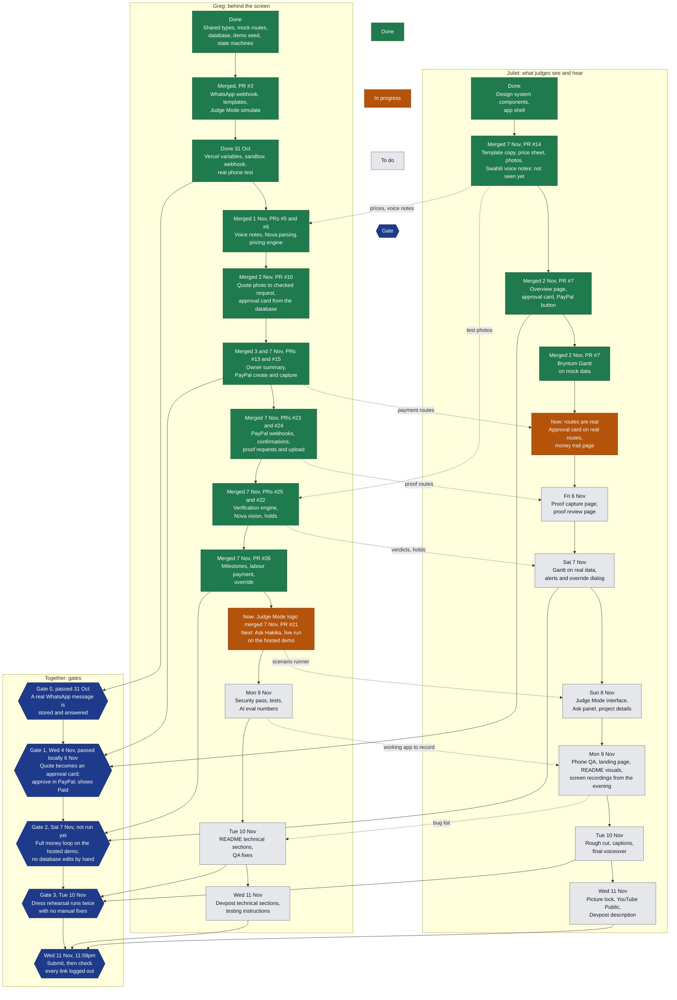
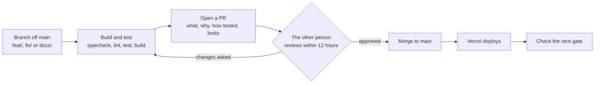

# Hakika roadmap

**Who:** Greg owns everything behind the screen. Juliet owns everything judges see and hear.
**Our submit deadline:** Wed 11 Nov, 11:59pm Nairobi. Devpost closes Thu 12 Nov, 11:00pm; treat that as a buffer only.
**Last updated:** Sat 7 Nov 2026.

> **Status: proposed.** These dates still need agreeing between Greg and Juliet. They fit about 20 days of Greg's planned work and all of Juliet's remaining build into 11 days, so they are very tight. If a gate slips, use the [cut order](#if-a-gate-slips).
>
> **Where we are, 7 Nov:**
> - **Greg's routes through Sat 7 Nov are merged, plus Judge Mode logic from Sun 8 Nov.** The quote pipeline and owner summary landed 2–3 Nov ([#10](https://github.com/youneedgreg/Hakika/pull/10), [#13](https://github.com/youneedgreg/Hakika/pull/13)). On 7 Nov, `main` gained PayPal orders ([#15](https://github.com/youneedgreg/Hakika/pull/15)), webhooks and the money trail ([#23](https://github.com/youneedgreg/Hakika/pull/23)), proof codes and upload ([#24](https://github.com/youneedgreg/Hakika/pull/24)), the verification engine ([#25](https://github.com/youneedgreg/Hakika/pull/25)), Nova vision and holds ([#22](https://github.com/youneedgreg/Hakika/pull/22)), the milestone flow with labour payment and override ([#26](https://github.com/youneedgreg/Hakika/pull/26)), and the Judge Mode scenario runner ([#21](https://github.com/youneedgreg/Hakika/pull/21)). CI passes on `main`.
> - **Gate 1 passed in local testing on 6 Nov**, not yet on the hosted demo. **Gate 2 has not been run:** the full loop on the hosted demo with real phones is the next job, and it is a day late.
> - **Juliet's template copy and price sheet** merged on 7 Nov ([#14](https://github.com/youneedgreg/Hakika/pull/14)). Her screens from [#7](https://github.com/youneedgreg/Hakika/pull/7) already call the API routes. Now that those routes are real, each screen needs checking on real data. The Judge Mode page still calls the old simulate route and needs moving to the new scenario and chat routes.
> - **Not started:** Ask Hakika (its route is still a stub), the security pass and the AI eval numbers.

## Workflow

Solid arrows are the order of work inside a lane. Dotted arrows are hand-offs: the other person needs this before they can finish.

## Day by day

| Date | Greg | Juliet | Gate |
|---|---|---|---|
| **By Mon 2 Nov** | Done 31 Oct: Vercel variables, sandbox webhook, real phone test | Send template copy (EN and SW), price sheet and quotes, Swahili voice notes, code photos and site photos | **Gate 0, passed 31 Oct:** a real WhatsApp message is stored and answered with a template |
| **Tue 3 Nov** | Merged 1 Nov: Groq Whisper translation, Nova parsing and quote reading, pricing engine, daily USD/KES rate, over 40 pricing tests. Merged 2 Nov ([#10](https://github.com/youneedgreg/Hakika/pull/10)): quote photo to checked request | Merged 2 Nov: overview page, approval card and PayPal button on mock data | Done: a quote photo becomes a parsed request; pricing tests pass |
| **Wed 4 Nov** | Merged: owner summary with number guard (3 Nov, [#13](https://github.com/youneedgreg/Hakika/pull/13)), PayPal create order (supplier as payee) and capture (7 Nov, [#15](https://github.com/youneedgreg/Hakika/pull/15)) | Merged 2 Nov: Bryntum Gantt on mock data | **Gate 1:** quote to approval card, approve in PayPal sandbox, shows Paid. **Passed locally 6 Nov; not yet on the hosted demo** |
| **Thu 5 Nov** | Merged 7 Nov ([#23](https://github.com/youneedgreg/Hakika/pull/23), [#24](https://github.com/youneedgreg/Hakika/pull/24)): PayPal webhooks, WhatsApp confirmations, audit events, proof codes, single-use links, upload, WhatsApp pin fallback | Approval card on real routes, money trail page | Payments appear in the money trail; a phone proof is stored with code, location and time. **Not run with a real phone yet** |
| **Fri 6 Nov** | Merged 7 Nov ([#25](https://github.com/youneedgreg/Hakika/pull/25), [#22](https://github.com/youneedgreg/Hakika/pull/22)): verification engine (dHash, duplicates, geofence, freshness, code), Nova vision checks, outcome rule, holds | Proof capture page (Android Chrome and iPhone Safari), proof review page | Test photos get the expected verdicts. **Done in tests and on Nova with demo photos** |
| **Sat 7 Nov** | Merged 7 Nov ([#26](https://github.com/youneedgreg/Hakika/pull/26)): milestone flow, labour payment, fresh proof request, override with logged reason | Gantt on real data, alerts, override dialog, loading and error states | **Gate 2:** full money loop on the hosted demo with real phones. **Not run yet** |
| **Sun 8 Nov** | Ask Hakika (read-only tools). Done early, merged 7 Nov ([#21](https://github.com/youneedgreg/Hakika/pull/21)): Judge Mode scenario runner, reset, labelled replay | Judge Mode interface (move it to the new scenario and chat routes), Ask panel, project details page | Someone new runs all 3 scenarios from Judge Mode alone |
| **Mon 9 Nov** | Prompt-injection tests, upload and rate limits, secrets check, tests at 80%+ on pricing, verification and state machines, AI eval numbers | Phone QA with a bug list to Greg, landing page, README visuals. Screen recordings start in the evening | Injection tests pass; working app ready to record |
| **Tue 10 Nov** | QA fixes, README technical sections. Bug fixes only from here | Rough cut under 3:00, captions, final voiceover | **Gate 3:** dress rehearsal runs twice with no manual fixes |
| **Wed 11 Nov** | Devpost technical sections, testing instructions with the sandbox buyer login, friend follows the README | Picture lock, YouTube Public, Devpost description | **Submit by 11:59pm**, then open every link logged out |
| **Thu 12 Nov** | Buffer only; fix only what is broken | Buffer only | Devpost closes at 11:00pm |
| **To Tue 15 Dec** | Keep the hosted demo, Judge Mode and sandbox accounts working. No migrations and nothing judges might be testing | Keep the Gantt working: check the Bryntum trial lasts past 15 Dec | Judging runs 1 to 15 Dec |

## How we work

- **The contract is `src/shared/types.ts`, `src/shared/api.ts` and the API routes.** Tell the other person before changing them.
- **Work against mock routes until the real one lands.** A route that is still mock data sends the `x-hakika-mock: 1` header.
- **At least three commits a day each,** using Conventional Commits, so the history shows the work inside the hackathon window.

## Rules that do not bend

- Code decides whether money can move. No model output can trigger a payment.
- Only the owner's PayPal approval moves money. The server computes every amount; the browser never sends a total.
- Messages to people on site are fixed English and Swahili templates. The model never writes to them.
- PayPal sandbox only. Hakika never holds funds.
- Only fictional people and demo photos go to the AI models.
- A model can be misled by text in a photo: in testing, Nova changed a supplier and a price because a quote told it to. So code checks what it reads, and a quote with text aimed at a model is discarded.
- WhatsApp only delivers our messages within 24 hours of the person's last message. Outside that, Hakika won't send; the owner will see an alert in the app instead. This check isn't built yet; it comes with the outbound templates. Before filming, every phone messages the sandbox first.

## If a gate slips

Cut in this order: stretch items, suggested questions, override dialog polish, landing page.

Never cut payments, verification, the Gantt, Judge Mode or the video.
