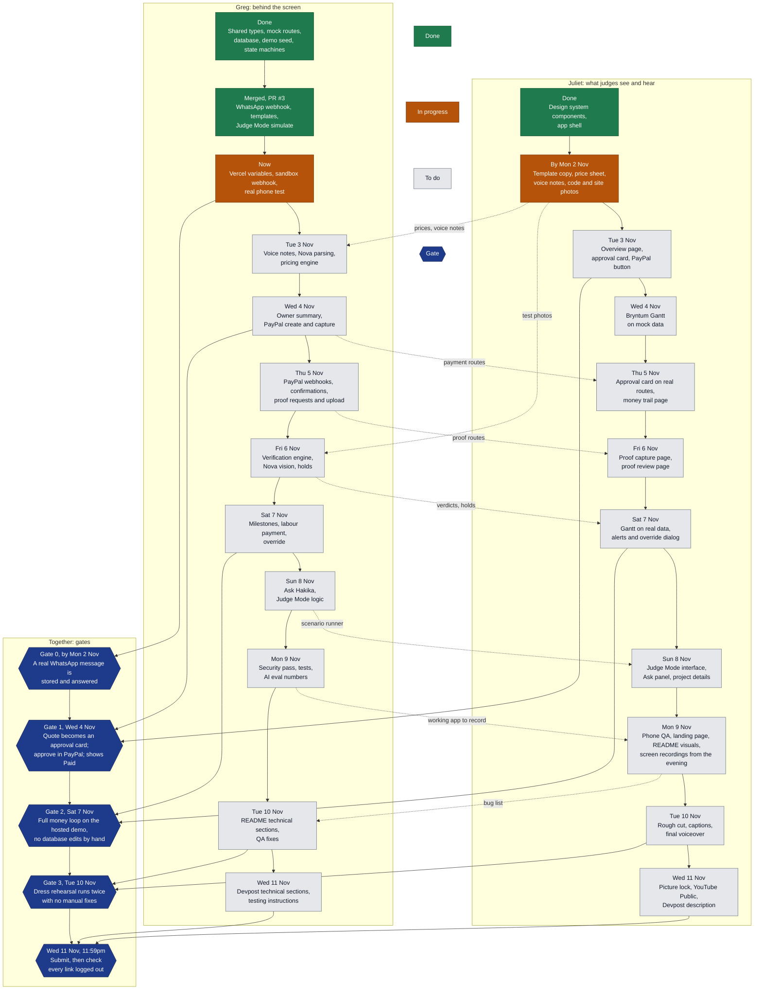
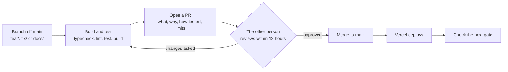

# Hakika roadmap

**Who:** Greg owns everything behind the screen. Juliet owns everything judges see and hear.
**Our submit deadline:** Wed 11 Nov, 11:59pm Nairobi. Devpost closes Thu 12 Nov, 11:00pm; treat that as a buffer only.
**Last updated:** Sat 31 Oct 2026.

> **Status: proposed.** These dates still need agreeing between Greg and Juliet. They fit about 20 days of Greg's planned work and all of Juliet's remaining build into 11 days, so they are very tight. If a gate slips, use the [cut order](#if-a-gate-slips).

## Workflow

Solid arrows are the order of work inside a lane. Dotted arrows are hand-offs: the other person needs this before they can finish.

## Day by day

| Date | Greg | Juliet | Gate |
|---|---|---|---|
| **By Mon 2 Nov** | Now that PR #3 has merged: Vercel variables, sandbox webhook, real phone test | Send template copy (EN and SW), price sheet and quotes, Swahili voice notes, code photos and site photos | **Gate 0:** a real WhatsApp message is stored and answered with a template |
| **Tue 3 Nov** | Groq Whisper translation, Nova parsing and quote reading, pricing engine, daily USD/KES rate, at least 12 pricing tests | Overview page, approval card and PayPal button on mock data | A quote photo becomes a parsed request; pricing tests pass |
| **Wed 4 Nov** | Owner summary with number guard, PayPal create order (supplier as payee) and capture | Bryntum Gantt on mock data | **Gate 1:** quote to approval card, approve in PayPal sandbox, shows Paid |
| **Thu 5 Nov** | PayPal webhooks, WhatsApp confirmations, audit events, proof codes, single-use links, upload, WhatsApp pin fallback | Approval card on real routes, money trail page | Payments appear in the money trail; a phone proof is stored with code, location and time |
| **Fri 6 Nov** | Verification engine (dHash, duplicates, geofence, freshness, code), Nova vision checks, outcome rule, holds | Proof capture page (Android Chrome and iPhone Safari), proof review page | Test photos get the expected verdicts |
| **Sat 7 Nov** | Milestone flow, labour payment, fresh proof request, override with logged reason | Gantt on real data, alerts, override dialog, loading and error states | **Gate 2:** full money loop on the hosted demo with real phones |
| **Sun 8 Nov** | Ask Hakika (read-only tools), Judge Mode scenario runner, reset, labelled replay | Judge Mode interface, Ask panel, project details page | Someone new runs all 3 scenarios from Judge Mode alone |
| **Mon 9 Nov** | Prompt-injection tests, upload and rate limits, secrets check, tests at 80%+ on pricing, verification and state machines, AI eval numbers | Phone QA with a bug list to Greg, landing page, README visuals. Screen recordings start in the evening | Injection tests pass; working app ready to record |
| **Tue 10 Nov** | QA fixes, README technical sections. Bug fixes only from here | Rough cut under 3:00, captions, final voiceover | **Gate 3:** dress rehearsal runs twice with no manual fixes |
| **Wed 11 Nov** | Devpost technical sections, testing instructions with the sandbox buyer login, friend follows the README | Picture lock, YouTube Public, Devpost description | **Submit by 11:59pm**, then open every link logged out |
| **Thu 12 Nov** | Buffer only; fix only what is broken | Buffer only | Devpost closes at 11:00pm |
| **To Tue 15 Dec** | Keep the hosted demo, Judge Mode and sandbox accounts working. No migrations and nothing judges might be testing | Keep the Gantt working: check the Bryntum trial lasts past 15 Dec | Judging runs 1 to 15 Dec |

## How we work

- **The contract is `src/shared/types.ts`, `src/shared/api.ts` and the API routes.** Tell the other person before changing them.
- **Work against mock routes until the real one lands.** A route that is still mock data sends the `x-hakika-mock: 1` header.
- **At least three commits a day each,** using Conventional Commits, so the history shows the work inside the hackathon window.

## Rules that do not bend

- Code decides whether money can move. No model output can trigger a payment.
- Only the owner's PayPal approval moves money. The server computes every amount; the browser never sends a total.
- Messages to people on site are fixed English and Swahili templates. The model never writes to them.
- PayPal sandbox only. Hakika never holds funds.
- Only fictional people and demo photos go to the AI models.

## If a gate slips

Cut in this order: stretch items, suggested questions, override dialog polish, landing page.

Never cut payments, verification, the Gantt, Judge Mode or the video.
